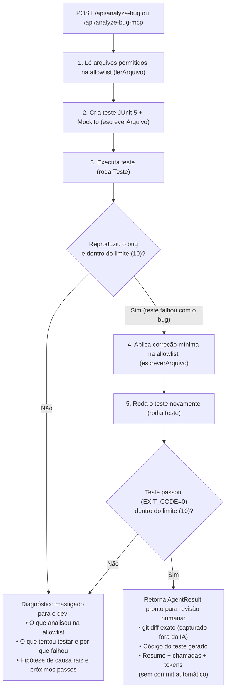

# Demo — Agente de Classificação e Correção de Bugs com Spring AI + MCP

Projeto demonstrativo em **Java 21 + Spring Boot 3.2.5 + Spring AI 1.1.8 (Google Gemini)** que mostra, na prática, como construir um agente de IA seguro para **classificar stack traces**, **reproduzir bugs via teste unitário (JUnit 5 + Mockito)**, **propor a correção mínima** e devolver o `git diff` pronto para revisão humana — tanto com **Tools locais (`@Tool`)** quanto via **MCP (*Model Context Protocol*)**.

---

## Qual problema esta demo resolve?

Em sistemas reais em produção, times de engenharia enfrentam dois gargalos recorrentes quando ocorre uma exceção:
1. **Triagem manual e despadronizada:** ler *stack traces* repetitivos para identificar módulo, camada e causa raiz. Respostas em texto livre de uma LLM não servem para persistir em banco, gerar métricas ou automatizar fluxos.
2. **Risco ao automatizar correções com IA:** dar acesso irrestrito ao repositório, deixar a LLM alterar módulos não relacionados, rodar comandos arbitrários ou fazer `git commit`/`git push` sem validação.

Esta demo resolve os dois pontos combinando:
- **Structured Output** (`.responseEntity(BugClassification.class)`) para classificação determinística em JSON tipado (`record` Java).
- **Tool Calling com Guardrails rígidos no código Java** (*allowlist* de arquivos, proteção contra *path traversal*, limite de chamadas, timeout e truncamento de logs).
- **Validação por teste unitário (TDD automatizado):** o agente primeiro cria um teste que **falha** reproduzindo o bug, depois aplica a correção mínima e só conclui quando o teste fica **verde** — sem nunca fazer commit automático.
- **Desacoplamento via MCP Server:** separa o orquestrador da LLM das ferramentas que tocam no disco e no Maven.

---

## Arquitetura do Repositório

O projeto é um multi-módulo Maven composto por 3 aplicações Spring Boot 3.2.5 independentes:

```text
demo-agente-bugs/
├── pom.xml                        # POM agregador Maven
├── target-app/                    # Aplicação "vítima" com bug proposital
│   └── src/main/java/br/demo/
│       ├── matricula/
│       │   ├── Aluno.java
│       │   ├── Turma.java
│       │   ├── AlunoRepository.java
│       │   └── MatriculaService.java       # Contém o bug (NullPointerException na linha 18)
│       └── financeiro/
│           └── FolhaPagamentoService.java  # Arquivo proibido (fora da allowlist)
│
├── codebase-mcp-server/           # Servidor MCP (porta 8081, Streamable HTTP em /mcp)
│   └── src/main/java/br/demo/mcp/
│       ├── CodebaseMcpServerApplication.java
│       ├── config/McpToolsConfig.java      # Expõe ToolCallbackProvider via MCP
│       └── tools/CodebaseMcpTools.java     # @Tool com allowlist e guardrails no servidor
│
└── bug-agent-server/              # Servidor do Agente (porta 8080)
    └── src/main/java/br/demo/agent/
        ├── BugDemoAgentApplication.java
        ├── controller/BugAgentController.java
        ├── model/
        │   ├── BugReportRequest.java       # Entrada: URI + stack trace + allowlist
        │   ├── BugClassification.java      # Saída estruturada da classificação
        │   └── AgentResult.java            # Saída final: resumo, diff, teste, chamadas e tokens
        ├── service/
        │   ├── BugClassifierService.java   # Classificação estruturada (Structured Output)
        │   └── BugFixAgentService.java     # Orquestrador (Tools locais e Cliente MCP)
        └── tools/
            └── ScopedCodeBaseTools.java    # Tools locais por requisição (Marco 3/4)
```

---

## Fluxo Pensado

### 1. Classificação Estruturada (`POST /api/classify-bug`)
Recebe a URI e o *stack trace*, aplica um *System Prompt* com **listas fechadas** de valores válidos e `temperature=0.0`, e devolve um `BugClassification` já tipado (`modulo`, `camada`, `tipoExcecao`, `categoriaCausa`, `resumo`), registrando o consumo de tokens.

### 2. Loop do Agente de Correção e Fluxo de Decisão (`POST /api/analyze-bug` e `POST /api/analyze-bug-mcp`)

Um princípio central desta demo é que o agente **nunca "chuta" uma correção sem validação** e **nunca deixa o desenvolvedor de mãos vazias**:
- **Caminho feliz (bug reproduzido e corrigido):** o agente entrega o teste JUnit passando, o `git diff` mínimo e o resumo para revisão humana.
- **Caminho de fallback (não conseguiu reproduzir, o teste não passou ou estourou o limite de 10 chamadas):** em vez de insistir em loop infinito ou inventar código, o agente **mastiga tudo o que aprendeu** — arquivos inspecionados, causa provável, o que tentou testar, qual erro ocorreu na execução e a sugestão de correção para o desenvolvedor finalizar rapidamente.



- **`POST /api/analyze-bug` (Tools locais):** instancia `ScopedCodeBaseTools` por requisição dentro do próprio `bug-agent-server`.
- **`POST /api/analyze-bug-mcp` (MCP):** descobre e invoca as ferramentas remotamente no `codebase-mcp-server` (`http://localhost:8081/mcp`) via **Streamable HTTP**, com contagem e limite de chamadas aplicados por requisição no cliente e *allowlist* imposta pelo servidor MCP.

---

## Guardrails de Segurança

A segurança não depende apenas do prompt — todas as travas são aplicadas no código Java:
- **Allowlist estrita:** leitura bloqueada para qualquer arquivo fora da lista permitida (ex.: `FolhaPagamentoService.java` retorna `"Acesso negado"` e gera log `WARN`). Escrita liberada apenas para a allowlist ou pasta de testes `src/test/java/br/demo/matricula/`.
- **Proteção contra *path traversal*:** caminhos são normalizados e validados contra `..` e caminhos absolutos, garantindo permanência dentro de `target-app/`.
- **Proteção contra *command injection*:** o nome da classe de teste em `rodarTeste` é validado por regex (`^[A-Za-z0-9_.$#]+$`).
- **Timeout e economia de tokens:** execução do Maven limitada a **60 segundos** com saída truncada para as **últimas 50 linhas**.
- **Limite de passos (*max steps*):** máximo de **10 chamadas de tool** por requisição (`AtomicInteger`). Ao atingir o limite, o agente é orientado a encerrar e devolver um diagnóstico sem inventar correções.
- **Revisão humana obrigatória:** nenhuma tool executa `git commit` ou `git push`; o `git diff` é coletado fora da LLM para inspeção antes de qualquer merge.

---

## Como Rodar e Testar

### Pré-requisitos
- **Java 21+** (o projeto usa `./mvnw`, não exige Maven global)
- Chave da API do Google Gemini configurada na variável de ambiente `GEMINI_API_KEY`
- Repositório Git com `target-app/` rastreado (necessário para o `git diff` exibir as alterações)

### 1. Compilar todos os módulos
```bash
./mvnw clean test-compile
```

### 2. Subir os servidores
1. **Servidor MCP (porta `8081`)** — necessário para o endpoint `/api/analyze-bug-mcp`:
   ```bash
   ./mvnw -pl codebase-mcp-server spring-boot:run
   ```
2. **Servidor do Agente (porta `8080`)**:
   ```bash
   GEMINI_API_KEY="sua-chave-aqui" ./mvnw -pl bug-agent-server spring-boot:run
   ```

### 3. Endpoints disponíveis

| Endpoint | Descrição |
| :--- | :--- |
| `POST /api/classify-bug` | Classifica o *stack trace* retornando JSON estruturado (`BugClassification`). |
| `POST /api/analyze-bug` | Executa o agente usando **Tools locais** (`ScopedCodeBaseTools`). |
| `POST /api/analyze-bug-mcp` | Executa o agente consumindo o **`codebase-mcp-server`** via MCP Streamable HTTP. |

#### Exemplo de requisição (também salvo em `teste-analyze-bug.txt`)
```bash
curl -X POST http://localhost:8080/api/analyze-bug-mcp \
  -H "Content-Type: application/json" \
  -d '{
    "uri": "/sistema/graduacao/matricula/confirmar",
    "stackTrace": "java.lang.NullPointerException: Cannot invoke \"br.demo.matricula.Turma.getCodigo()\" because the return value of \"br.demo.matricula.Aluno.getTurma()\" is null\n\tat br.demo.matricula.MatriculaService.confirmarMatricula(MatriculaService.java:18)",
    "allowlist": [
      "src/main/java/br/demo/matricula/MatriculaService.java",
      "src/main/java/br/demo/matricula/Aluno.java",
      "src/main/java/br/demo/matricula/Turma.java",
      "src/main/java/br/demo/matricula/AlunoRepository.java"
    ]
  }'
```

### 4. Resetar o `target-app` entre testes
Após o agente corrigir o `MatriculaService.java` e criar o teste unitário, volte o cenário ao estado original com:
```bash
git checkout -- target-app/ && git clean -fd target-app/
```

---

## Por que usar MCP e como evoluir para produção?

Separar o `codebase-mcp-server` transforma as ferramentas em um serviço padronizado que pode ser reutilizado por múltiplos clientes (outros agentes, IDEs, CLIs), rodando em **sandbox isolado** e compondo facilmente com outros servidores MCP (Jira/GitLab, Kibana/Sentry, banco de dados).

Para levar essa arquitetura a produção com custo e segurança sob controle:
- **Deduplicação por assinatura de stack trace:** executar o agente 1 vez por bug único, nunca por ocorrência repetida.
- **Triagem em cascata:** usar um modelo leve para classificar/filtrar (Marco 2) e acionar o agente de correção apenas para bugs elegíveis.
- **Prompt/Context Caching + JavaParser:** reduzir o custo de tokens repetidos no loop e enviar apenas métodos/assinaturas relevantes em classes grandes.
- **Autenticação no MCP Server:** proteger o endpoint `/mcp` com OAuth2/API Key e executar o ambiente de build/teste em containers efêmeros sem acesso à rede interna.
